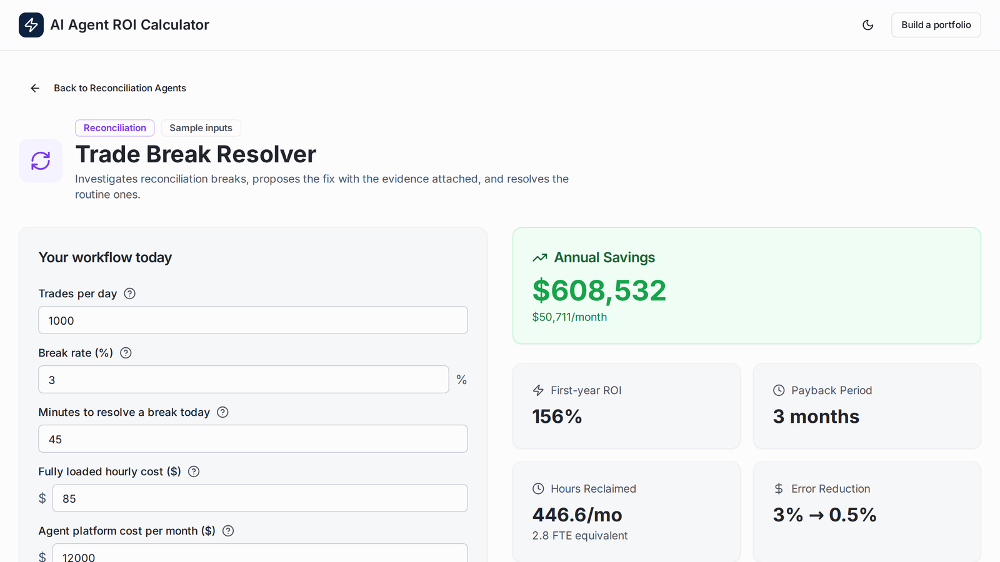

# AI Agent ROI Calculator

**A defensible business case for an AI agent, built one workflow at a time: hours reclaimed, net savings, payback and first-year ROI.**

[Live demo](https://gabbyignacio7.github.io/ai-agent-roi-calculator/) · Sample inputs



## The problem

A bank or asset manager looking at AI agents for operations does not buy "AI". It buys relief for specific workflows: trade breaks, confirmation review, settlement instructions, regulatory reporting. Each one has its own volumes, handling times, error costs and controls. A vendor slide with one blended savings number does not survive a finance review. The buyer needs a case per workflow, built on their own numbers, with every assumption visible.

## What it does

- **Single-agent calculator.** Pick a workflow, enter volumes, minutes per item, fully loaded hourly cost, error rate and cost per error. Results update as you type.
- **11 workflow calculators in 4 families:** Communications, Reconciliation, Settlements, and Lending and Compliance Operations.
- **Modelled assumptions on screen.** Each calculator shows the share of work the agent handles, the human review time per item and the error rate with the agent, so a reviewer can challenge them.
- **Agent costs as inputs.** Platform cost per month and one-time implementation cost are editable, so the case is net of what the agent costs to run and to stand up.
- **Multi-agent portfolio builder.** Select several agents, adjust each one's inputs, and see rolled-up annual savings, hours and FTE capacity, net savings per dollar of platform cost, and payback on total implementation cost.
- **Embeddable view** at `#/embed/<family>/<agent>` for dropping a single calculator into a proposal page.

## How the math works

All of it lives in [`client/src/lib/roi.ts`](client/src/lib/roi.ts) and is covered by unit tests.

| Measure | Formula |
|---|---|
| Hours with the agent | (volume × (1 − automation rate) × manual minutes + volume × automation rate × review minutes) ÷ 60 |
| Current monthly cost | current hours × hourly cost + current error, rework or penalty cost |
| Monthly cost with the agent | new hours × hourly cost + remaining error cost + platform cost per month |
| Monthly savings | current monthly cost − monthly cost with the agent |
| Annual savings | monthly savings × 12 |
| Payback | implementation cost ÷ monthly savings (not shown when savings are negative) |
| First-year ROI | (annual savings − implementation cost) ÷ (implementation cost + 12 × platform cost) |
| FTE capacity | hours reclaimed per month ÷ 160 |

Each workflow defines how volume and error cost are measured. Trade breaks are priced through the share that become failed settlements. Regulatory reporting is priced through annual exposure scaled by the error rate. Settlement instructions are priced through failed settlements per month.

## What I owned

As Technical PM at an AI software company, I built the original version of this calculator for the sales team, so they could estimate client value across the company's agent families. I prototyped it on Replit, moved it to GitHub Pages, and added the multi-agent portfolio builder so a prospect could see the combined case across several workflows.

For this public version I replaced the vendor's pricing schedule with editable cost inputs, put every modelling assumption on screen, made ROI a first-year measure that counts platform fees, and added unit tests for the core math.

## Run it

```bash
git clone https://github.com/gabbyignacio7/ai-agent-roi-calculator.git
cd ai-agent-roi-calculator
npm install
npm run dev        # local app
npm test           # unit tests
npm run build      # production build in dist/
```

## About this repo

Agent names, workflow assumptions and default inputs are illustrative samples for a generic financial institution. No client data, employer data, product names or pricing are included.

**Stack:** React, TypeScript, Vite, Tailwind CSS, shadcn/ui components, wouter (hash routing for GitHub Pages), Vitest, GitHub Actions.

Shared as a portfolio piece. All rights reserved.

Built by [Gabriel Ignacio](https://7thfloorventures.com), 7th Floor Ventures.
